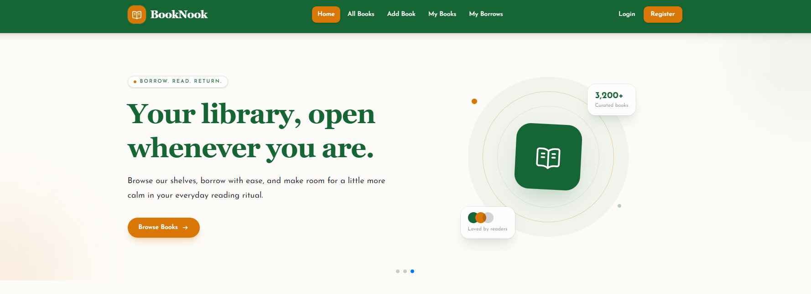

<div align="center">

# 📚 BookNook

### A small online library: *add a book, borrow a book, return a book.*

[](https://book-nook-client-site.vercel.app/)
[](https://booknook-server-site.vercel.app/)


**🔗 Live:** [https://book-nook-client-site.vercel.app](https://book-nook-client-site.vercel.app/)

</div>

---

## 📖 Table of Contents

- [📚 BookNook](#-booknook)
    - [A small online library: *add a book, borrow a book, return a book.*](#a-small-online-library-add-a-book-borrow-a-book-return-a-book)
  - [📖 Table of Contents](#-table-of-contents)
  - [🌿 About the Project](#-about-the-project)
  - [📸 Screenshots](#-screenshots)
    - [🏠 Home](#-home)
    - [📚 All Books](#-all-books)
    - [🔐 Login](#-login)
  - [✨ Key Features](#-key-features)
  - [🧭 Pages and Routes](#-pages-and-routes)
  - [🛠️ Tech Stack](#️-tech-stack)
  - [📁 Project Structure](#-project-structure)
  - [🚀 Getting Started](#-getting-started)
    - [Prerequisites](#prerequisites)
    - [Installation](#installation)
    - [Available Scripts](#available-scripts)
  - [🔑 Environment Variables](#-environment-variables)
  - [🔐 Authentication Flow](#-authentication-flow)
  - [☁️ Deployment](#️-deployment)
  - [🔗 Related Repository](#-related-repository)
  - [📬 Contact](#-contact)

---

## 🌿 About the Project

**BookNook** is a small online library where readers can browse a shared collection, add their own books, borrow a book for a few days, and return it when they are done.

The idea is simple: **add a book, borrow a book, return a book.** Every user manages their own books and their own borrowed list, and all private data is protected with **Better Auth** and **JWT** verification on the server.

This repository contains the **client side** (Next.js). The Express and MongoDB API lives in the [server repository](#-related-repository).

---

## 📸 Screenshots

### 🏠 Home



### 📚 All Books


### 🔐 Login


---

## ✨ Key Features

- 🔐 **Secure authentication** with Better Auth, the MongoDB adapter, email and password sign-up, and Google social login.
- 🎟️ **JWT protected API.** The client sends a fresh token with each private request and the server verifies it against the Better Auth JWKS endpoint.
- 🛡️ **Private routes.** Add Book, My Books and My Borrows are protected by a proxy. Guests are sent to Login and returned to the page they wanted after signing in.
- 🔄 **Persistent login.** A logged-in user is not logged out when reloading a private route.
- 🎠 **Home slider** built with Swiper.js, with three slides and a "Browse Books" button.
- 🆕 **New Arrivals.** The six latest books are loaded dynamically from MongoDB, newest first.
- 📚 **All Books** in a responsive grid of equal-height cards with image, title, author, category and a "View Details" button.
- 📄 **Book Details** page with full information, the user who added the book, and a "Borrow This Book" button.
- ➕ **Add Book** form with image upload to **imgbb**, a category select, and read-only name and email taken from the logged-in user.
- ✏️ **My Books.** Users see only the books they added, edit them in a pre-filled modal, and delete them after a custom confirmation modal.
- 📥 **Borrow system.** A modal confirms the borrow, a 14 day return date is set, and the same user cannot borrow the same book twice at the same time.
- 📤 **My Borrows** table with image, title, borrow date, return date and a "Return Book" button.
- 🔔 **Toast notifications** for every success and error message, with no default browser alerts.
- ⏳ **Loading spinners** while data is loading.
- 🚫 **Custom 404 page** with a "Back to Home" button.
- 🏷️ **Dynamic page titles** on each route.
- 📱 **Fully responsive** layout for mobile, tablet and desktop.
- 🔑 **Password validation** on registration: at least 6 characters, one uppercase and one lowercase letter.

---

## 🧭 Pages and Routes

| Page | Route | Access |
| --- | --- | --- |
| Home | `/` | Public |
| All Books | `/AllBooks` | Public |
| Book Details | `/AllBooks/[id]` | 🔒 Private |
| Add Book | `/add-book` | 🔒 Private |
| My Books | `/my-books` | 🔒 Private |
| My Borrows | `/my-borrows` | 🔒 Private |
| My Profile | `/profile` | 🔒 Private |
| Login | `/login` | Public |
| Register | `/register` | Public |
| 404 Not Found | any unknown path | Public |

**Navbar behaviour**

- Logged out: logo, links, and **Login** and **Register** buttons.
- Logged in: the user's photo. Clicking it opens a dropdown with the user's name, email, **My Profile** and **Logout**.

---

## 🛠️ Tech Stack

| Category | Technology |
| --- | --- |
| **Framework** | Next.js 16 (App Router) |
| **Language** | TypeScript |
| **Styling** | Tailwind CSS |
| **UI Components** | shadcn/ui |
| **Authentication** | Better Auth, MongoDB Adapter, JWT plugin |
| **Database** | MongoDB (Atlas) |
| **Slider** | Swiper.js |
| **Notifications** | Sonner (toast) |
| **Icons** | Lucide React, React Icons |
| **Image Upload** | imgbb API |
| **Deployment** | Vercel |

**Backend (separate repository):** Express.js, MongoDB driver, `jose` for JWT verification, CORS, dotenv.

---

## 📁 Project Structure

```text
book-nook-client-site/
├── public/
├── screenshots/            # README images
├── src/
│   ├── app/
│   │   ├── page.tsx            # Home
│   │   ├── AllBooks/           # All books and book details
│   │   ├── add-book/           # Add book (private)
│   │   ├── my-books/           # Update and delete (private)
│   │   ├── my-borrows/         # Borrowed books (private)
│   │   ├── login/              # Login
│   │   ├── register/           # Register
│   │   ├── profile/            # My profile
│   │   ├── api/auth/[...all]/  # Better Auth route handler
│   │   └── layout.tsx
│   ├── components/
│   │   ├── Navbar.tsx
│   │   ├── Footer.tsx
│   │   └── ui/                 # shadcn/ui components
│   ├── lib/
│   │   ├── auth.ts             # Better Auth server config
│   │   ├── auth-client.ts      # Better Auth client
│   │   └── book-utils.ts       # API URL, categories, image upload, auth headers
│   └── proxy.ts                # Private route protection
├── .env
└── package.json
```

---

## 🚀 Getting Started

### Prerequisites

- Node.js 20 or newer
- A MongoDB Atlas cluster
- A Google OAuth client (for Google login)
- An [imgbb](https://api.imgbb.com/) API key
- The [BookNook server](#-related-repository) running locally or deployed

### Installation

```bash
# 1. Clone the repository
git clone https://github.com/Partho-Mukherjee2003/book-nook-client-site.git

# 2. Go into the project
cd book-nook-client-site

# 3. Install dependencies
npm install

# 4. Create your .env file (see the next section)

# 5. Start the development server
npm run dev
```

Open [http://localhost:3000](http://localhost:3000) in your browser.

### Available Scripts

| Command | Description |
| --- | --- |
| `npm run dev` | Start the development server |
| `npm run build` | Create a production build |
| `npm run start` | Run the production build |
| `npm run lint` | Run ESLint |

---

## 🔑 Environment Variables

Create a `.env` file in the project root:

```env
# Better Auth
BETTER_AUTH_URL=http://localhost:3000
NEXT_PUBLIC_BETTER_AUTH_URL=http://localhost:3000
BETTER_AUTH_SECRET=your_long_random_secret

# MongoDB (used by Better Auth)
MONGODB_USERNAME=your_mongodb_username
MONGODB_PASSWORD=your_mongodb_password

# Google login
GOOGLE_CLIENT_ID=your_google_client_id
GOOGLE_CLIENT_SECRET=your_google_client_secret

# Express server
NEXT_PUBLIC_API_URL=http://localhost:5000

# Image upload
NEXT_PUBLIC_IMGBB_API_KEY=your_imgbb_api_key
```

> ⚠️ Never commit your `.env` file. Add it to `.gitignore`.
> For production, use your deployed URLs, for example `BETTER_AUTH_URL=https://book-nook-client-site.vercel.app` with no trailing slash.

---

## 🔐 Authentication Flow

1. The user registers or logs in with **Better Auth** (email and password, or Google). Sessions are stored in MongoDB.
2. A **proxy** checks for the session cookie before opening any private page. If there is none, the user is sent to `/login?redirect=<page>` and returned to that page after login.
3. For private API calls, the client requests a **JWT** from Better Auth and sends it as `Authorization: Bearer <token>`.
4. The Express server verifies the token against the Better Auth **JWKS** endpoint (`/api/auth/jwks`) and uses the verified email to return or change only that user's data.

---

## ☁️ Deployment

The client is deployed on **Vercel**.

1. Import the repository into Vercel.
2. Add all environment variables from the section above, using production URLs.
3. In Google Cloud Console, add this redirect URI to your OAuth client:
   `https://book-nook-client-site.vercel.app/api/auth/callback/google`
4. In MongoDB Atlas, allow network access from Vercel (`0.0.0.0/0`).
5. Make sure the server's `CLIENT_URL` matches `BETTER_AUTH_URL` exactly.
6. Redeploy after changing any `NEXT_PUBLIC_` variable.

---

## 🔗 Related Repository

| Repository | Description |
| --- | --- |
| **Client** (this repo) | Next.js front end |
| **Server** | [book-nook-server-site](https://github.com/Partho-Mukherjee2003/book-nook-server-site) |

---

## 📬 Contact

**Partho Mukherjee**

📧 Email: [parthomukherjee582@gmail.com](mailto:parthomukherjee582@gmail.com)
🌐 Live site: [book-nook-client-site.vercel.app](https://book-nook-client-site.vercel.app/)

---

<div align="center">

Made with 💚 for readers everywhere. **Happy reading!** 📖

</div>
